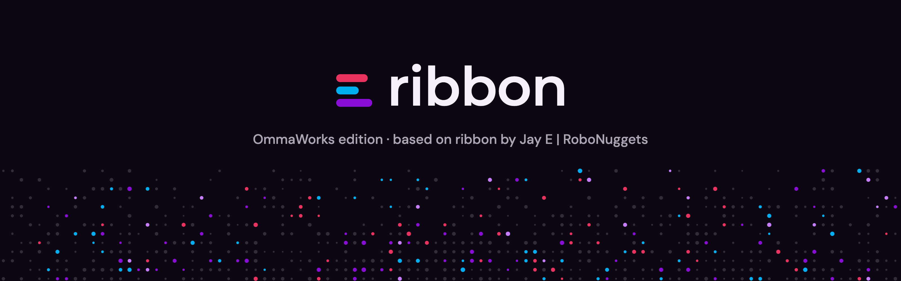
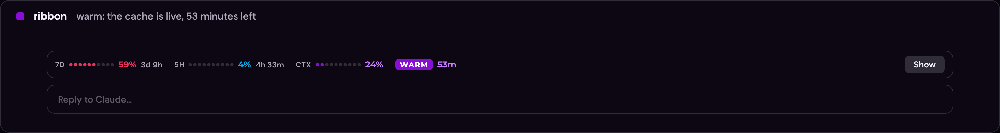
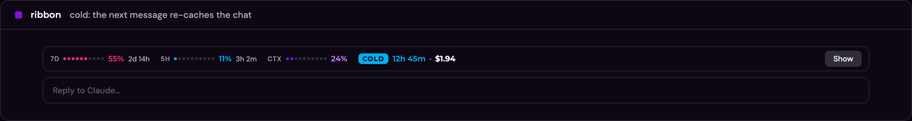
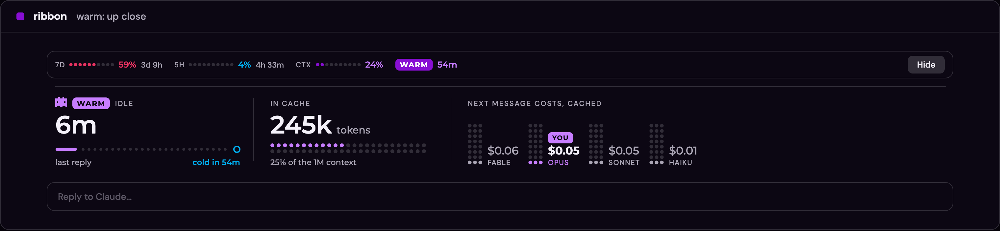
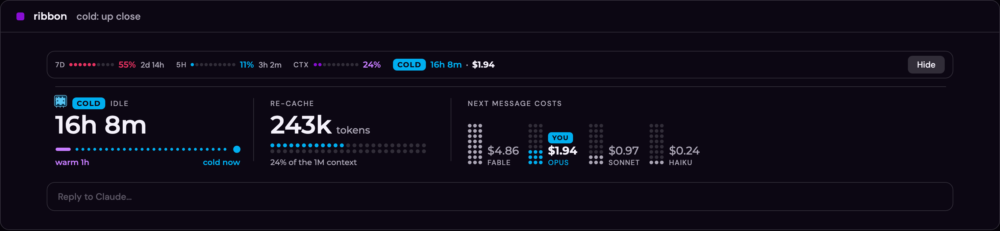

<p align="center">
  
</p>

# ribbon

A free mod for Claude Code. It adds a slim band above your prompt that shows:

- **How much usage you have left** in your 7-day and 5-hour windows, and when each one resets.
- **Whether your prompt cache is warm or cold**, and what your next message will cost.

It installs once and is there in every session after that. No commands to learn.

<p align="center">
  
</p>

<p align="center">
  
</p>

One row. That's the whole footprint.

## Install

The easy way: send this link to your agent and say "install this".

```
https://github.com/barisozpercin/ribbon
```

Your agent runs one command. The band shows up in your next session.

### For agents

If you are an agent and your user asked you to install this, run this in a shell:

```
claude plugin install ribbon --marketplace barisozpercin/ribbon
```

It installs for the user (all their projects) and adds the marketplace on its own. Then tell your user: "Ribbon is installed. Start a new session to see the band above your prompt." Do not edit their settings file by hand.

### By hand

In a Claude Code terminal session, type:

```
/plugin install ribbon --marketplace barisozpercin/ribbon
```

1. Type `y` when it asks `Add marketplace?`.
2. Pick the **user** scope with Enter.
3. Start a new session.

## What you see

### Usage left

- **7D** (OmmaVQ pink) is your 7-day window. **5H** (OmmaSign cyan) is your 5-hour window.
- Each dot bar shows what is **left**, not what is used.
- Under each one is when it resets, for example `resets 3d 9h`.
- If a window drops under 15%, a bold **LOW** shows next to it.

### The prompt cache

After your first reply, the band also tracks the prompt cache. The cache keeps your chat cheap to continue for one hour after your last message.

- **WARM** (Omma violet): the cache is live. It shows the minutes left.
- **COLD** (OmmaSign cyan): the hour has passed. Your next message re-sends the whole chat, so it costs more. It shows the price first.

Click **Show** to open the cache card, and **Hide** to fold it. The card always starts folded; the cold price is on the row itself.

The card shows how long you've been idle, how many tokens are in the cache, and what the next message costs on each model. Your model is marked **YOU**. See [Up close](#up-close) below.

### Always one row

The band never wraps. As it narrows it drops detail, in this order:

1. Shorter dot bars.
2. The `WARM` / `COLD` chip becomes a colored `●`.
3. Reset times go.
4. Dot bars go: `7D 88%  5H 42%  ● 42m`.
5. The cache dot, then the **Show** button, then all but the lowest window.

## Good to know

- **It costs nothing to run.** It reads the app's own numbers and draws them. It never calls a model.
- **Prices are estimates.** They come from a price table in `hooks/cache-art.ts` (`MODELS`), not from your bill. If prices change, edit that table.
- **Subagents don't count.** Only your main chat resets the cache clock.

## What is inside

```
ribbon/
├── .claude-plugin/
│   ├── plugin.json         the mod's name and version
│   └── marketplace.json    makes this repo installable
├── hooks/
│   ├── hooks.json          points to the module
│   ├── register.tsx        the band: usage, cache tracking, layout
│   ├── cache-art.ts        the cache card and robot drawings, the price table
│   └── font.ts             Montserrat and DM Sans, embedded so the drawings render anywhere
├── types/index.d.ts        the shape of what the band remembers
├── tests/                  7 tests: layouts, warm and cold, terminal, cleared sessions
└── assets/                 banner, screenshots, hex icon
```

## Remove it

```
claude plugin uninstall ribbon
```

## Develop it

Load the folder without installing it:

```
claude --plugin-dir ./ribbon
```

Run the tests:

```
claude plugin test ./ribbon
```

## Up close

Click **Show** and the band opens into the cache card.

**Warm.** The cache is live. Your next message is cheap.

<p align="center">
  
</p>

**Cold.** The hour has passed. Your next message re-sends the whole chat, so it costs more.

<p align="center">
  
</p>

## License

[MIT](LICENSE).

The embedded fonts are [Montserrat](https://github.com/JulietaUla/Montserrat) and [DM Sans](https://github.com/googlefonts/dm-fonts), both under the SIL Open Font License 1.1. Colors and type follow the OmmaWorks design system.

Made by Jay E from RoboLabs. Learn more at [RoboNuggets](https://robonuggets.com).

<p align="center">
  
</p>
